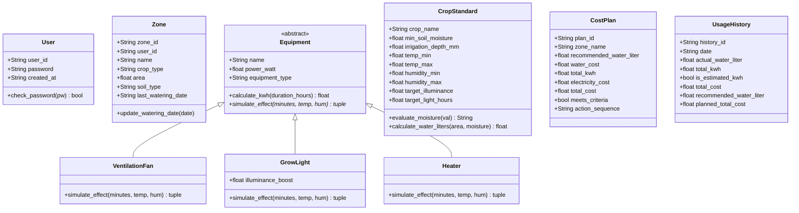

# 🌿 스마트팜 운영비 절감 프로그램 (SmartFarm Cost Optimizer)
> **11주차 객체지향프로그래밍 팀프로젝트**  
> 온실 센서 환경 분석 기반 최적 관개(급수) 및 장비(환기·보광·난방) 에너지 비용 절감 시스템

---

## 📌 1. 프로젝트 개요

스마트팜의 재배 구역별 환경 센서 데이터(토양 수분, 기온, 상대습도, 조도)를 수집·분석하여, 작물별 최적 생육 기준을 만족하면서도 **물 공급 비용과 전기 요금을 최소화하는 최적의 운영 조치 계획을 자동 산출하고 실적을 추적**하는 데스크톱 GUI 애플리케이션입니다.

- **프로그래밍 언어**: Python 3 (추가 외부 라이브러리 설치 불필요, 표준 라이브러리만 사용)
- **GUI 프레임워크**: `tkinter` / `ttk` (모던 에메랄드 그린 테마, 반응형 카드 및 대시보드)
- **데이터 영속성**: JSON 기반 로컬 파일 스토리지 (`data/`)

---

## 🏛 2. 객체지향 설계 (OOP Architecture)

본 프로그램은 **단일 책임 원칙(SRP)**, **관심사의 분리(Separation of Concerns)**, **다형성(Polymorphism)** 및 **계층형 아키텍처(Layered Architecture)**를 철저히 준수하여 설계되었습니다.

```
smartfarm/
│
├── main.py                     # 애플리케이션 메인 엔트리포인트 및 뷰 라우터
├── README.md                   # 프로젝트 명세 및 실행 가이드
│
├── models/                     # [도메인 모델 계층 (Domain Entities)]
│   ├── user.py                 # User (사용자 계정)
│   ├── zone.py                 # Zone (재배 구역: 작물, 면적, 토양, 급수일)
│   ├── environment.py          # EnvironmentRecord (환경 센서 측정값)
│   ├── equipment.py            # Equipment (장비 추상 클래스 & 환기팬, 보광등, 난방기)
│   ├── crop_standard.py        # CropStandard (작물별 적정 생육 기준치)
│   ├── cost_plan.py            # CostPlan & EquipmentOperation (비용 계획 및 시뮬레이션)
│   ├── usage_history.py        # UsageHistory (작업 실적 및 통계 이력)
│   └── settings.py             # SystemSettings (물·전기 단가 설정)
│
├── services/                   # [비즈니스 로직 계층 (Service Layer)]
│   ├── storage_service.py      # JSON 파일 영속성 및 기본값 시딩 관리
│   ├── auth_service.py         # 회원가입, 로그인 검증, 사용자 세션 관리
│   ├── zone_service.py         # 구역 등록, 수정, 삭제, 최근 급수일 갱신
│   ├── environment_service.py  # 측정값 유효성 검사 및 직전 대비 변화량 분석
│   ├── optimization_service.py # 관개량 계산, 후보 시뮬레이션, 최저비용 추천 엔진
│   └── history_service.py      # 실적 기록, 기간별 집계 통계, 계획 vs 실적 비교
│
├── ui/                         # [사용자 인터페이스 계층 (Presentation Layer)]
│   ├── styles.py               # 전역 컬러 팔레트, 폰트, ttk 위젯 스타일
│   ├── components/             # 재사용 가능한 커스텀 컴포넌트
│   │   ├── nav_bar.py          # 상단 글로벌 헤더 & 내비게이션 바
│   │   └── stat_card.py        # 지표 요약 카드 위젯
│   └── views/                  # 화면별 View
│       ├── auth_view.py        # [A: 1~7] 회원가입 / 로그인 / 최초 구역 등록
│       ├── home_view.py        # [A: 8] 메인 대시보드 및 구역 카드
│       ├── env_input_view.py   # [B: 9~14] 구역별 환경 입력 & 변화량 추적
│       ├── plan_view.py        # [C: 15~28] 저비용 운영 계획 계산 & 후보 비교
│       ├── history_view.py     # [D: 29~35] 실적 등록, 통계, 계획 vs 실적 비교
│       └── settings_view.py    # [E: 36] 구역 관리, 단가 및 작물 기준 설정
│
└── data/                       # 자동 생성 로컬 영속화 JSON 파일
```

### 📐 핵심 클래스 다이어그램 (Class Diagram)



---

## 📋 3. 요구사항 (자연어 구성 1~38) 완벽 반영 매핑

| 영역 | 항목 번호 | 세부 구현 내용 | 대응 소스 코드 |
|:---|:---:|:---|:---|
| **A. 시작, 가입 & 로그인** | 1 | 첫 화면에서 안내 문구와 [회원가입], [로그인] 선택 | `AuthView.show_welcome()` |
| | 2 | 회원가입 시 아이디, 비밀번호, 비밀번호 확인 입력 | `AuthView.show_register()` |
| | 3 | 아이디 중복, 공백, 비밀번호 불일치 유효성 검사 및 안내 | `AuthService.register()` |
| | 4 | 가입 성공 메시지 표시 후 로그인 화면으로 자동 전환 | `AuthView._handle_register()` |
| | 5 | 로그인 화면에서 아이디/비밀번호 입력 | `AuthView.show_login()` |
| | 6 | 계정 검증 및 구역/측정/급수 기록 세션 로드 | `AuthService.login()` |
| | 7 | 등록 구역 없는 신규 사용자는 최초 1회 구역 등록 다이얼로그 표시 | `AuthView._show_initial_zone_modal()` |
| | 8 | Home 화면에 프로그램 이름, 구역 목록, 3대 메뉴 및 시스템 버튼 표시 | `HomeView`, `TopNavBar` |
| **B. 메뉴 1: 구역별 환경 입력** | 9 | 구역 선택 시 작물 종류, 재배면적, 토양 종류 자동 표시 | `EnvInputView._on_zone_selected()` |
| | 10 | 최근 실제 급수일 자동 로드 및 직접 수정 입력 지원 | `EnvInputView.ent_last_water` |
| | 11 | 측정 일시, 토양수분(%), 기온(℃), 습도(%RH), 조도(lx) 입력 | `EnvInputView._build_ui()` |
| | 12 | 입력값 숫자 검사, 0~100% 범위 검사, 미래 급수일 방지 검사 | `EnvironmentRecord.validate_inputs()` |
| | 13 | 저장 및 직전 기록과의 변화량(예: 26% → 22%) 실시간 비교 표시 | `EnvironmentService.record_environment()` |
| | 14 | 다른 구역 연속 입력 및 [운영 계획 보기] 바로가기 연계 | `EnvInputView.plan_cta` |
| **C. 메뉴 2: 저비용 운영 계획** | 15 | [계획 계산] 시 최신 측정값, 기준치, 장비 소비전력, 유틸리티 단가 로드 | `OptimizationService.calculate_plan_for_zone()` |
| | 16 | 토양 수분 vs 기준 비교: '급수 필요' / '급수 보류' 및 최근 급수일 표시 | `CropStandard.evaluate_moisture()` |
| | 17 | 관개요구량(mm) × 면적(m²) = 권장 급수량(L) 자동 계산 | `CropStandard.calculate_water_liters()` |
| | 18 | 구역별 권장 급수량 표 표시 및 전체 합산 집계 | `PlanView._populate_all_zones_summary()` |
| | 19 | 기온·습도 적정 범위 비교 ('낮음' / '적정' / '높음') | `CropStandard.evaluate_temperature()` |
| | 20, 21 | 조도 비교 및 누적 일조 부족 시간 산출 안내 | `OptimizationService.calculate_plan_for_zone()` |
| | 22 | 장비 가동 후보군(최소 가동, 표준 10분, 집중 20분 등) 시뮬레이션 | `OptimizationService.candidates` |
| | 23 | 예상 온습도 및 작업 순서 안내 ('환기 10분 → 기온 재확인 → 보광') | `CostPlan.action_sequence` |
| | 24 | 장비별 소비전력(W) × 가동시간(h) = 예상 전력량(kWh) | `Equipment.calculate_kwh()` |
| | 25 | 물 비용(m³×단가) + 전기 비용(kWh×단가) = 총 예상 운영비 | `CostPlan.total_cost` |
| | 26 | 재배환경 기준 충족 후보 중 **최저 비용 계획** 자동 판정 및 추천 | `OptimizationService.min(valid, key=cost)` |
| | 27 | 급수 권장량, 가동 시간, 예상 온습도, 전력량, 항목별 비용 결과 카드 | `PlanView._render_optimal_plan()` |
| | 28 | [후보 비교] 상세 테이블 제공 및 [계획 저장] | `PlanView._save_current_plan()` |
| **D. 메뉴 3: 사용량·비용 이력** | 29 | 작업 후 저장된 운영 계획 불러오기 연동 | `HistoryView._on_plan_selected()` |
| | 30 | 실제 급수량, 장비별 가동 시간, 직접 실측 전력량 입력 | `HistoryView._build_ui()` |
| | 31 | 실측값 없을 시 소비전력 기준 전력량 추정 및 '(추정)' 표시 | `UsageHistory.is_estimated_kwh` |
| | 32 | [실적 저장] 및 실제 급수량 > 0 시 최근 급수일 자동 갱신 | `HistoryService.save_actual_record()` |
| | 33 | 조회 기간 필터 (오늘, 7일, 30일, 전체) 및 구역/작물 필터 | `HistoryService.filter_histories()` |
| | 34 | 기간별 총 물 사용량, 보광 시간, 전력량, 물·전기·총비용 집계 | `HistoryService.calculate_statistics()` |
| | 35 | 계획 대비 실제 작업량 및 비용 차이 비교 (권장 vs 실제) | `HistoryView.tree_history` |
| **E. 설정, 로그아웃 & 종료** | 36 | 구역 수정/추가/삭제, 작물 기준, 장비 소비전력, 물·전기 단가 설정 | `SettingsView` |
| | 37 | [홈] 누르면 이동, [로그아웃] 시 확인 후 첫 화면 복귀 | `SmartFarmApplication.on_logout()` |
| | 38 | [종료] 시 미저장 확인 대화상자 후 안전 종료 | `SmartFarmApplication.on_exit()` |

---

## 🚀 4. 실행 방법

### 요구 사양
- Python 3.8 이상 (Windows, macOS, Linux 지원)
- Python 표준 내장 라이브러리만 사용하므로 `pip install` 없이 바로 실행 가능합니다.

### 실행 명령어
```bash
python main.py
```

### 테스트용 데모 계정 (빠른 체험)
- **아이디**: `farmer`
- **비밀번호**: `123`
- *첫 화면의 `⚡ 체험용 데모 계정으로 바로 시작` 버튼을 누르면 1초 만에 로그인되어 등록된 A구역(토마토), B구역(상추) 데이터를 바로 확인하실 수 있습니다.*
